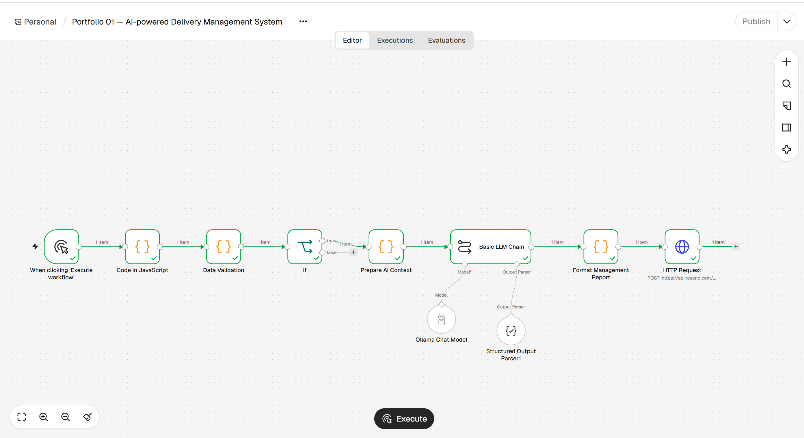
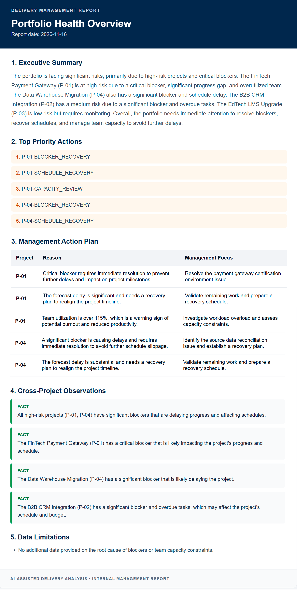

# Portfolio 01 — AI-powered Delivery Management System

AI-powered IT project portfolio analysis and management reporting using n8n, Qwen3 and Ollama.

---

## Project Overview

The project was created to demonstrate how Artificial Intelligence (AI) can be used to automate some of the daily tasks of a Project Manager.

### Technologies Used

- **n8n** — a platform for creating and automating workflows;
- **Qwen3** — an AI language model used to analyse information and generate recommendations;
- **Ollama** — a tool for running AI language models locally, so there is no need to connect Qwen3 through a paid API;
- **Resend API** — used to send the report automatically by email.

The prompts for data analysis were written in JavaScript with the help of ChatGPT. n8n and Ollama were deployed in Docker.

The project was designed to be completely free and to run on my personal computer. Its main goal is to help a manager assess the overall status of a project portfolio faster, identify problem areas, and receive recommendations to support management decisions.

## Data Preparation and Validation

For the demonstration, I created test data for four IT projects and defined their content myself. This means I knew in advance that the data met the required conditions.

At the same time, I added a separate **Data Validation** stage to the workflow. It checks whether the structure of the input data is correct. This is especially important in a real company, where information may come from different systems, such as Jira, CRM, or ERP, and may have different formats. For example, some text may use an encoding that an LLM cannot read correctly.

## Project Architecture

The workflow consists of the following nodes:

1. **Code (JavaScript)** — provides the input data for analysis, including project information, teams, and workload.

2. **Data Validation** — checks the input data and verifies its structure.

3. **IF — Validation Passed** — selects the next workflow path:
   - **True** — the data has the correct format, so the workflow continues;
   - **False** — the data has an incorrect format, so it does not continue through the main analysis path.

4. **Prepare AI Context** — prepares the prompt and context for AI analysis based on the input data.

5. **Basic LLM Chain** — manages the AI analysis process. It includes:
   - **Ollama Chat Model** — connects the workflow to the locally running Qwen3 AI model;
   - **Structured Output Parser** — defines the expected structure and format of the Qwen3 response so that the next workflow nodes can process the results correctly.

6. **Format Management Report** — uses JavaScript to create the final report in HTML format and organise the information into clear sections.

7. **HTTP Request** — connects to the external Resend service through its API and sends the completed report to my personal Gmail address.

## Final Report

The report I received by email contains the following sections:

- **Report Title** — the report name and date.
- **Executive Summary** — an overall assessment of the project portfolio and the main AI findings.
- **Top Priority Actions** — actions that require the most immediate attention.
- **Management Action Plan** — a table with recommended management actions.
- **Cross-Project Observations** — findings identified by analysing several projects together.
- **Data Limitations** — limitations and missing information in the input data that may affect the analysis results.

## Project Outcome

As a result, the manager receives a single, structured report that helps identify project problems, set priorities, and review recommendations for solving the identified issues.

